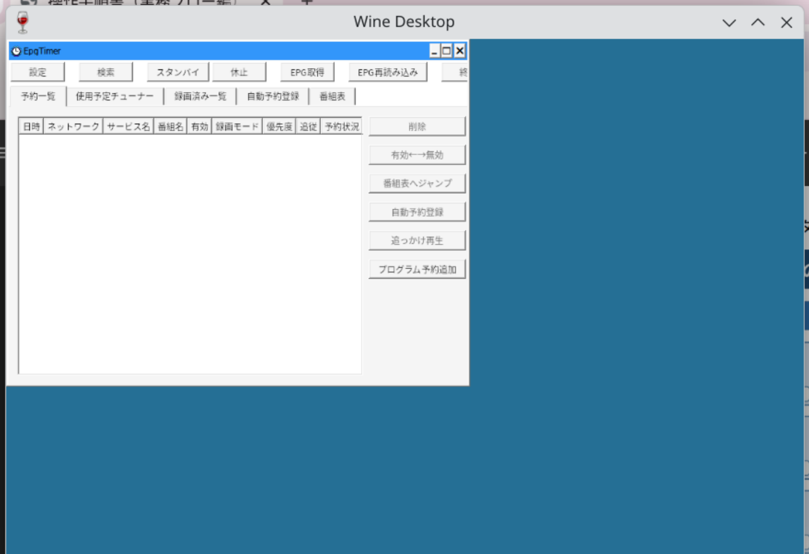
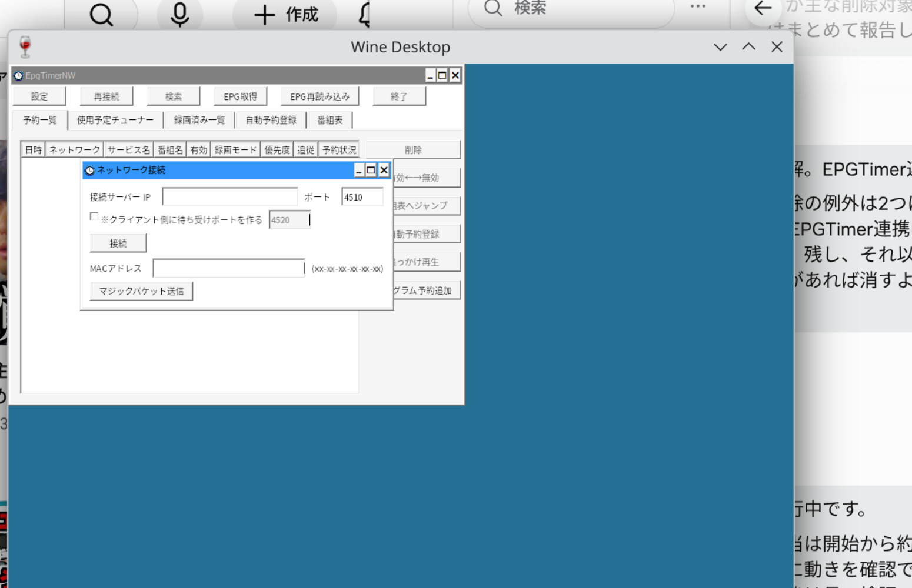
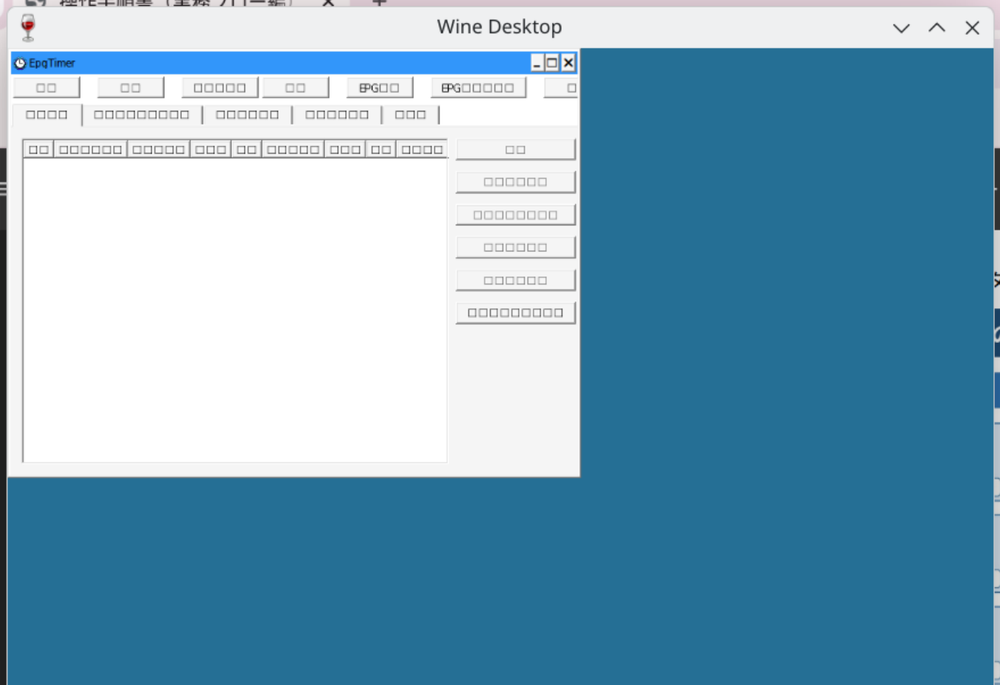

# edcb-epgtimer-wine

**EDCB のフロントエンド EpgTimerNW を、Wine で Linux 上で動かすための配布パッケージです。**（配布物は NW 版のみです）

録画サーバー（EpgTimerSrv）は別の Windows サーバーで動かし、Linux マシンからはこのフロントだけを使う構成を主用途としています。日本語が文字化け（豆腐）になる問題への対策済みビルドを含みます。

- 本家: [xtne6f/EDCB](https://github.com/xtne6f/EDCB)（EpgTimer core 版、net10.0-windows）
- 検証環境: Arch Linux / KDE Plasma、Wine 11.22（2026-11-27 実機検証）

## 構成

```
┌────────────────────────────┐          ┌──────────────────────────────┐
│ Linux マシン (このパッケージ) │  TCP     │ Windows サーバー               │
│                            │  4510番  │                              │
│  EpgTimerNW.exe            │ ───────▶ │  EpgTimerSrv.exe             │
│   (Wine 上で動作)           │ ◀─────── │   (チューナー・録画・EPG 管理)  │
│  EpgTimerNW.exe (NW版のみ)  │  通知     │  EpgDataCap_Bon.exe          │
└────────────────────────────┘          └──────────────────────────────┘
```

- フロントと srv の通信は本家純正の CtrlCmd プロトコル（TCP）そのままです。**プロトコルには一切手を入れていません**
- `EpgTimerNW.exe` は `EpgTimer.exe` と同一バイナリで、**実行ファイル名が `EpgTimerNW` で始まると NW モードになる**本家仕様を利用しています。NW モードでは起動直後からリモートの EpgTimerSrv へ接続しに行くため、「srv は別サーバー」構成の正規フロントになります

## スクリーンショット

### メイン画面（予約一覧）



Wine 上でメイン画面が起動し、日本語が正常に表示されています（srv 未接続のため予約一覧は空です）。

### EpgTimerNW（リモート接続用フロント）



NW 版を起動すると「ネットワーク接続」ダイアログが開きます。接続サーバー IP とポート（既定 4510）を入れて「接続」を押すのが初回の流れです。タイトルバーが `EpgTimerNW` になり、ツールバーに「再接続」が出るのが NW モードの目印です。

### 日本語フォント対策の前後比較

対策前（全ての日本語が豆腐 □ になっています）:



対策後（正常表示）:


## 動作環境と前提

| 項目 | 内容 |
|---|---|
| OS | Arch Linux で検証（他ディストリビューションは手動セットアップで利用可） |
| Wine | 11.22（wine-mono を含む） |
| 日本語フォント | noto-fonts-cjk（Noto Sans CJK JP）が必須 |
| .NET | 不要（win-x64 self-contained ビルドのため、ランタイムは同梱済み） |
| srv 側 | EpgTimerSrv でネットワーク接続（NW）が許可されていること |

## インストール

### install.sh を使う（Arch Linux）

```bash
tar xzf edcb-epgtimer-wine.tar.gz
cd edcb-epgtimer-wine
./install.sh
```

install.sh は次を行います。

1. `pacman` で wine / wine-mono / noto-fonts-cjk を導入（sudo）
2. 本体を `~/.local/share/edcb-epgtimer-wine/` へ配置
3. **ショートカットを自動作成**
   - アプリケーションメニュー: `~/.local/share/applications/EpgTimerNW.desktop`
   - デスクトップ: XDG デスクトップディレクトリ（`~/Desktop` 等）へ同じものをコピーし、実行可能ビットと信頼済みマーク（`gio metadata::trusted`）を付与（デスクトップが無い環境では警告を出してスキップ）

### 手動で使う

install.sh を使わず、展開したフォルダの `start.sh` を直接実行しても起動できます。

```bash
./start.sh          # EpgTimerNW（リモート接続用）
```

初回起動時に専用 Wine プレフィックス（`~/.local/share/edcb-epgtimer-wine/prefix`）が自動作成され、ホストの Noto CJK フォントの取り込みとフォント代替の登録（`fonts.reg`）まで自動で行われます。

## 使い方

1. メニューの「EpgTimerNW (Wine)」、デスクトップのショートカット、または `start.sh` から起動
2. 初回は「ネットワーク接続」ダイアログで、接続サーバーの IP アドレスとポート（既定 4510）を入力して「接続」
   - クライアント側に待ち受けポートを作る方式（既定 4520）もダイアログで選択できます（srv 側が許可している場合）
   - Wake-on-LAN 用の MAC アドレス入力とマジックパケット送信もこのダイアログにあります
3. 接続情報や各種設定は、exe と同じフォルダの設定ファイルに保存されます
   - `EpgTimerNW.exe.xml`（`app/` フォルダ内）

> このパッケージに srv の接続先やパスワードなどの個人設定は含まれていません。接続先は各自の初回起動時に入力してください。

## 日本語フォント対策について

Wine でそのまま起動すると、日本語が全て豆腐（□）になりました。原因と対策は2段構えです。

**原因**: EpgTimer の既定フォントは「メイリオ」前提ですが、Wine 環境には日本語グリフを持つフォントが無く、WPF のフォントフォールバックが効かないため、文字が □ になります。

**対策1（環境）**: ホストの Noto CJK フォントをプレフィックスの `windows/Fonts` へコピーし、`fonts.reg` で MS UI Gothic / MS Gothic 等から Noto Sans CJK JP へのフォント代替と FontLink を登録します（`start.sh` が初回起動時に自動実施）。

**対策2（ソース）**: 本家ソースの既定値そのものを変えるパッチ [edcb-wine-font.patch](edcb-wine-font.patch) を当てたビルドを同梱しています。変更は `EpgTimer/EpgTimer/Common/SettingClass.cs` の4行のみです。

- 番組表などのフォント既定値（`FontName` / `FontNameTitle`）: メイリオ → Noto Sans CJK JP
- アプリ全体フォント（`AppFontName`）: メイリオ → Noto Sans CJK JP、あわせて `SetAppFont` の既定値を有効化

これにより、設定ファイルを一切用意しなくても初回起動から日本語が正常表示されます。フォントは設定画面で後から変更できます。

## 既知の制限と未検証事項

- **実 srv への接続は未検証**です（検証時点で接続先サーバーの提供が無かったため）。NW 版が起動し、ネットワーク接続ダイアログが日本語で正常表示されることまでは実証済みです。番組表・予約・自動予約などの実操作は、実際の srv に接続しての確認が別途必要です
- TVTest 連携、EpgTimer プラグイン、タスクトレイ常駐、スリープ／休止連携など Windows 固有機能は未検証です（NW 構成では多くが対象外です）
- 初回起動時にウィンドウが背面や最小化状態で開く場合があります。その場合はウィンドウ一覧から「EpgTimerNW」を選んでください
- Wayland 環境では Wine の仮想デスクトップウィンドウ（Wine Desktop）内に表示されます
- 他ディストリビューションでは install.sh が使えません。Wine 11 以降 + wine-mono + Noto Sans CJK を手動で入れ、`start.sh` を使ってください

## ビルド方法（自分でビルドする場合）

前提: .NET 10 SDK（Linux 上で Windows 向けに発行します）

```bash
git clone https://github.com/xtne6f/EDCB.git
cd EDCB
git apply /path/to/edcb-wine-font.patch
cd EpgTimer/EpgTimer

# NW 版（AssemblyName を変えるだけ。同一バイナリの改名が NW 版になります）
dotnet publish EpgTimer.core.csproj -c Release -r win-x64 \
  --self-contained true -p:EnableWindowsTargeting=true \
  -p:AssemblyName=EpgTimerNW -o out/epgtimernw
```

WPF アプリでも `EnableWindowsTargeting` を付ければ Linux 上でビルドできることが、本検証で確認できました。

## ライセンスとクレジット

- EpgTimer / EDCB 本体は [xtne6f/EDCB](https://github.com/xtne6f/EDCB) の成果物であり、そのライセンスに従います。本リポジトリは本家の権利表示をそのまま保持します
- 本リポジトリが追加したのは、Wine で動かすための起動スクリプト（`start.sh` / `install.sh`）、ショートカット定義、日本語フォント対策（`fonts.reg` と上記パッチ）、およびドキュメントのみです
- アイコンは本家 EpgTimer のリソース（TaskIconBlue.ico）を変換したものです
